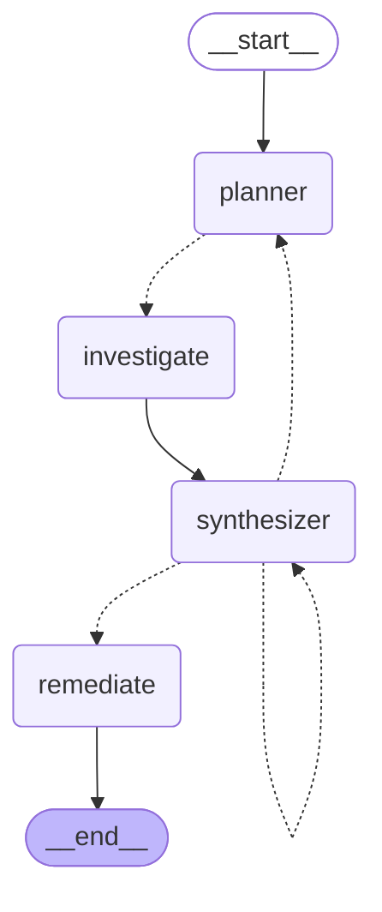

# On-Call Sentinel 🚨

**An async, fault-tolerant incident triage and remediation state machine built with LangGraph, FastAPI, and PostgreSQL.**

On-Call Sentinel demonstrates how to engineer production AI systems as **deterministic state machines** rather than fragile `while` loops or opaque autonomous agent wrappers. When an infrastructure alert fires, Sentinel concurrently fans out diagnostic workers, protects context-window budgets via head+tail bounded state reducers, validates LLM-proposed CLI commands against deterministic security guardrails, persists every super-step to PostgreSQL, and suspends execution via native human-in-the-loop (`interrupt()`) before touching production infrastructure.

---

## 🏗️ Why LangGraph Over Plain Loops or Autonomous Frameworks?

| Architecture | Where It Excels | Where It Breaks Down in Production |
| :--- | :--- | :--- |
| **Plain Python Loop** | Simple linear chains, DAGs, and single-turn tool calls where state fits in memory. | Requires brittle boilerplate to manage async fan-out/fan-in, state serialization across container restarts, and multi-day human approval pauses. |
| **High-Level Agent Frameworks** *(e.g., CrewAI, AutoGen)* | Rapid prototyping with opinionated role-playing abstractions. | Hides prompt construction, context growth, and routing behind framework magic—making infinite loops and misroutes hard to debug or bound. |
| **LangGraph** *(This Repo)* | Complex cyclic workflows, concurrent map-reduce, and long-running stateful processes. | Treats the LLM as a node inside a **predictable state machine**—giving you explicit control over state schemas, reducers, guardrails, and durable checkpoints. |

---

## 🔀 Graph Topology

Exported directly via `graph.get_graph().draw_mermaid()`:



### Production Engineering Mechanics Demonstrated
1. **True Async Concurrency (`Send` API + `AsyncPostgresSaver`):** `planner` dynamically dispatches concurrent `investigate` coroutines across Kubernetes logs, Git commits, and metrics on the `asyncio` event loop.
2. **Head+Tail Bounded Context Reducer (`bounded_findings_reducer`):** Instead of appending unbounded stack traces into state forever, a custom reducer deduplicates entries, preserves the head (service/timestamp metadata) and tail (root exceptions/exit codes) of oversized logs, and maintains a sliding window of the most recent evidence.
3. **Deterministic Security Guardrails & Self-Correction (`guardrails.py`):** Before a proposed CLI command can reach a human operator, a regex denylist and command-prefix allowlist validate it. Unsafe LLM proposals (e.g., `rm -rf` or `kubectl delete namespace`) are rejected deterministically and routed back to `synthesizer` with policy feedback to self-correct.
4. **Confidence-Gated Cycles with Hard Bounds:** `synthesizer` uses Pydantic structured outputs. If `confidence_score < 0.8`, conditional edges loop back to `planner` for targeted deeper log inspection—strictly capped at `iteration >= 3` to guarantee termination.
5. **Native Human-in-the-Loop (`interrupt()`) & Time-Travel Debugging:** Execution checkpoints to PostgreSQL and halts cleanly without holding open threads or HTTP connections. Operators can kill the worker process (`Ctrl+C`), resume seamlessly via CLI or stateless webhooks by `thread_id`, or rewind history (`aget_state_history`) to fork state and replay alternate remediations.

---

## 🚀 Quickstart

### 1. Start PostgreSQL & Configure Environment
```bash
docker compose up -d
uv sync --extra dev
cp .env.example .env  # Add your OPENAI_API_KEY
```

`uv` reads `.python-version` (3.12) and installs the locked dependency set from `uv.lock` into `.venv`, so every machine resolves identically. Prefer pip? `pip install -e ".[dev]"` still works.

> **Port note:** the container publishes on **5433** so it never collides with a local PostgreSQL on `5432`. `DATABASE_URL` in `.env.example` already matches; change both together if you use a different port.

### 2. CLI Mode: Run an Incident & Test Crash Recovery
```bash
uv run python scripts/run_incident.py incident-101
```
1. Watch the graph concurrently fan out 3 async workers on Iteration 0, detect low confidence (`< 0.8`), and loop back for deeper K8s `OOMKilled` logs.
2. When the graph pauses at `=== HUMAN APPROVAL REQUIRED ===`, **press `Ctrl+C` to simulate a worker crash**.
3. Re-run `uv run python scripts/run_incident.py incident-101`. LangGraph loads the checkpoint from PostgreSQL and resumes directly at the approval prompt without re-running prior LLM calls.
4. Enter `yes` (or type a custom override command—note that human overrides are also validated by `guardrails.py`).

### 3. Time-Travel Debugging
Inspect saved super-steps in PostgreSQL, rewind to the checkpoint prior to remediation, inject a modified command, and replay:
```bash
uv run python scripts/time_travel.py incident-101
```

### 4. Event-Driven Webhook Mode (Slack / PagerDuty Integration)
In production, on-call engineers approve actions from Slack or PagerDuty rather than a terminal. `src/api.py` exposes stateless FastAPI webhooks backed by a shared `AsyncPostgresSaver` connection pool—allowing worker processes to exit completely while paused at `interrupt()` and resume on any pod when an approval webhook arrives:

```bash
# Start the FastAPI webhook server
uv run uvicorn src.api:app --reload --port 8000

# 1. Simulate an incoming PagerDuty alert (runs until interrupt() and pauses)
curl -X POST http://localhost:8000/webhooks/alert \
  -H "Content-Type: application/json" \
  -d '{"incident_id": "inc-500", "alert_summary": "502 errors on checkout-api"}'

# 2. Simulate an operator clicking 'Approve' in Slack (resumes from Postgres)
curl -X POST http://localhost:8000/webhooks/approve \
  -H "Content-Type: application/json" \
  -d '{"thread_id": "inc-500", "decision": "yes"}'
```

Both endpoints return `status: "paused"` plus the pending `interrupt` payload, or `status: "completed"` once remediation finishes. Re-posting an alert for an existing `incident_id` is idempotent—it will not restart a paused investigation.

> **Windows note:** psycopg's async driver cannot use Windows' default `ProactorEventLoop`. The CLI scripts select a `SelectorEventLoop` automatically, and `uvicorn --reload` does the same. Running `uvicorn src.api:app` **without** `--reload` on Windows will fail on the first checkpoint read—use `--reload` locally, or run the server on Linux/Docker.

---

## 🧪 Testing & CI/CD Strategy

### Running Async Unit & Integration Tests Locally
The test suites in `tests/` swap `AsyncPostgresSaver` for LangGraph's in-memory checkpointer (`MemorySaver`) and mock OpenAI structured outputs. This validates head+tail reducers, security guardrails, retry bounds, self-correction loops, FastAPI webhook lifecycles, and `Command(resume=...)` suspension flows deterministically in milliseconds with zero network or API costs:

```bash
uv run pytest -v
```

### Note on GitHub Actions CI/CD
Automated GitHub Actions workflows (`.github/workflows/ci.yml`) are omitted to keep this repository a self-contained local sandbox without external runner dependencies. In a **production deployment**, enforce graph determinism on every pull request using the following workflow:

```yaml
# Recommended Production Workflow (.github/workflows/ci.yml)
name: Graph Determinism CI
on: [push, pull_request]
jobs:
  test:
    runs-on: ubuntu-latest
    steps:
      - uses: actions/checkout@v4
      - uses: astral-sh/setup-uv@v5
        with:
          python-version: "3.12"
      - run: uv sync --extra dev
      - run: uv run pytest -v
```

---

## 📂 Project Structure

```text
langgraph-incident-sentinel/
├── .env.example
├── .gitattributes             # LF line-ending normalization for cross-platform checkouts
├── .gitignore
├── .python-version            # Dev interpreter pin (3.12) for uv / pyenv / mise
├── docker-compose.yaml        # Local PostgreSQL 16 instance for checkpoint persistence
├── pyproject.toml             # Dependencies, dev extras & pytest config
├── uv.lock                    # Committed lockfile for reproducible environments
├── README.md
├── src/
│   ├── __init__.py
│   ├── config.py               # Lazy LLM factory & .env loading (import-safe, no credentials)
│   ├── state.py                # TypedDict state schema & head+tail bounded reducer
│   ├── guardrails.py           # Deterministic CLI command security & denylist policy
│   ├── tools.py                # Async mock K8s, Git, and metrics observability tools
│   ├── nodes.py                # Async planner, workers, structured synthesizer, HITL node
│   ├── graph.py                # StateGraph wiring, Send() map-reduce, cycle & safety edges
│   └── api.py                  # Stateless FastAPI webhook endpoints for Slack/PagerDuty HITL
├── scripts/
│   ├── __init__.py
│   ├── run_incident.py         # Async CLI runner with AsyncPostgresSaver & crash resume
│   └── time_travel.py          # Async state history inspection, rewinding & state forking
└── tests/
    ├── __init__.py
    ├── test_graph_routing.py   # Offline async pytest suite for routing, reducers & guardrails
    └── test_api.py             # Async HTTP lifecycle tests for alert & approval webhooks
```
